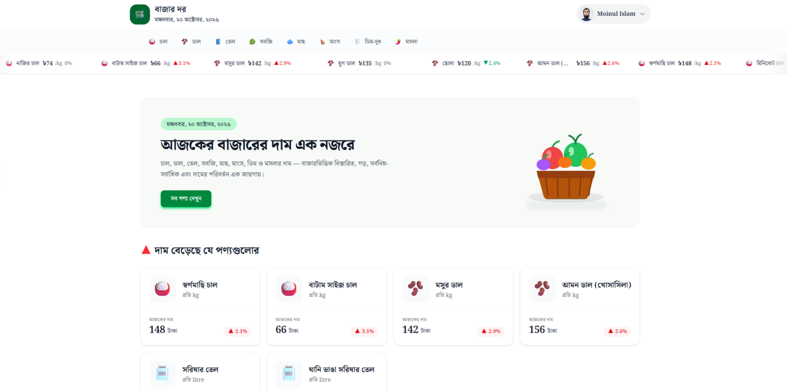

# 🛒 Bazardor — বাজার দর

<div align="center">
  <br />
  <a href="#-features">
    
  </a>
  <br /><br />

  
  
  
  
  
  
  

  <br /><br />

  <p><b>A market price tracking application built to explore authentication and modern Next.js architecture.</b></p>
</div>

---

## 📋 Table of Contents

1. [Introduction](#-introduction)
2. [Learning Objectives](#-learning-objectives)
3. [Tech Stack](#️-tech-stack)
4. [Features](#-features)
5. [Project Structure](#-project-structure)
6. [Prerequisites](#-prerequisites)
7. [Getting Started](#-getting-started)
8. [Environment Variables](#-environment-variables)
9. [API Integration](#-api-integration)
10. [Deployment](#️-deployment)
11. [Useful Links](#-useful-links)
12. [License](#-license)

---

## 🚀 Introduction

**Bazardor (বাজার দর)** is a market price tracking web application built with Next.js, React, and TypeScript. It allows users to explore products by category, view product details, and access available market price information through API integration.

However, this project is not just about displaying market prices. Its primary learning focus is **implementing authentication with Better Auth and understanding how authentication fits into the Next.js App Router architecture**.

While developing Bazardor, I explored server-side authentication operations, protected routing, Server and Client Components, caching, and other practical Next.js concepts.

The project combines a real-world application structure with hands-on experimentation to develop a deeper understanding of authentication and modern full-stack web development.

## 🎯 Learning Objectives

The primary goal of this project is to understand authentication beyond simply connecting a sign-in form to an authentication library.

I focused on exploring the following concepts:

- 🔐 **Better Auth Integration** — Implementing authentication and session-related functionality.
- ⚙️ **Server Actions** — Handling authentication-related operations through server-side actions instead of relying entirely on the client-side auth client.
- 🖥️ **Server and Client Components** — Understanding their differences, responsibilities, and appropriate use cases.
- 🛡️ **Protected Routing** — Using Next.js `proxy.ts` to handle authentication-based access control and navigation.
- ⚡ **Caching and Revalidation** — Exploring Next.js caching mechanisms and applying them to data fetching where appropriate.
- 🚫 **Custom 404 Page** — Implementing a custom not-found page for unmatched routes.
- ⏳ **Loading UI** — Using route-level loading UI for product detail pages.
- 🔔 **Toast Notifications** — Using React Toastify to provide feedback for user interactions and authentication operations.
- 🧩 **Type-Safe Development** — Defining TypeScript types for product and category data.

My goal is to understand why these techniques are used, how they work together, and when they are appropriate—not merely to make the application work.

## ⚙️ Tech Stack

| Technology | Purpose |
|---|---|
| [Next.js](https://nextjs.org/) | App Router, routing, server-side functionality, and rendering |
| [React](https://react.dev/) | Component-based UI development |
| [TypeScript](https://www.typescriptlang.org/) | Type-safe application development |
| [Better Auth](https://www.better-auth.com/) | Authentication and session management |
| [MongoDB](https://www.mongodb.com/) | Database integration for authentication, as configured |
| [Tailwind CSS](https://tailwindcss.com/) | Utility-first styling and responsive layouts |
| [HeroUI](https://www.heroui.com/) | UI components |
| [React Icons](https://react-icons.github.io/react-icons/) | Interface icons |
| [Lucide React](https://lucide.dev/) | Interface icons |
| [React Toastify](https://fkhadra.github.io/react-toastify/) | Toast notifications |
| [Biome](https://biomejs.dev/) | Code formatting and linting |
| [Vercel](https://vercel.com/) | Deployment platform |

## ⚡ Features

### Authentication

- 🔐 **Email and Password Authentication** — User registration and sign-in with Better Auth.
- 🌐 **Google OAuth** — Social sign-in with Google, when configured.
- 🐙 **GitHub OAuth** — Social sign-in with GitHub, when configured.
- 🔒 **Session Management** — Retrieve and manage authenticated user session information.
- 👤 **Profile Page** — Provide a dedicated page for user-related information.
- 🛡️ **Protected Routes** — Handle access to protected pages using Next.js routing capabilities.
- ⚙️ **Server-Side Authentication Operations** — Use Server Actions for supported authentication-related operations.

### Next.js Concepts

- 🖥️ **Server and Client Components** — Separate server-side responsibilities from interactive client-side UI.
- ⚡ **Caching and Revalidation** — Apply Next.js caching strategies where appropriate.
- 🔀 **Dynamic Routing** — Organize product detail pages using category and product route parameters.
- ⏳ **Loading UI** — Display a loading state while product detail content is being loaded.
- 🚫 **Custom 404 Page** — Display a custom not-found page for unmatched routes.
- 🧩 **Reusable Components** — Keep the UI organized into shared and feature-specific components.

### Market Price Tracking

- 🛍️ **Product Listing** — Display available products and market price information.
- 🗂️ **Category-Based Browsing** — Navigate products by category.
- 🔎 **Product Details** — Access individual product information through dynamic routes.
- 📊 **Price Information** — Display available market prices and price ranges.
- ↕️ **Product Sorting** — Organize products using the implemented sorting functionality.
- 🌐 **API Integration** — Retrieve product information from the Bazardor API.

### User Experience

- 📱 **Responsive Interface** — Support mobile, tablet, and desktop layouts.
- 🔔 **Toast Notifications** — Provide feedback using React Toastify.
- 🧭 **Shared Navigation** — Reusable header, navigation, and footer components.
- 📅 **Live Date Display** — Display the date through a dedicated UI component.

> OAuth availability depends on provider configuration. The exact authentication methods and behavior depend on the implementation and environment configuration.

## 📁 Project Structure

```text
bazardor-app/
├── src/
│   ├── app/
│   │   ├── (auth)/
│   │   │   ├── sign-in/
│   │   │   │   └── page.tsx
│   │   │   └── sign-up/
│   │   │       └── page.tsx
│   │   ├── api/
│   │   │   └── auth/
│   │   │       └── [...all]/
│   │   │           └── route.ts
│   │   ├── components/
│   │   │   ├── home/
│   │   │   │   ├── BannerSection.tsx
│   │   │   │   ├── ItemCard.tsx
│   │   │   │   └── ProductSorting.tsx
│   │   │   └── shared/
│   │   │       ├── footer/
│   │   │       │   └── Footer.tsx
│   │   │       └── header/
│   │   │           ├── AuthenticationButtons.tsx
│   │   │           ├── AuthSection.tsx
│   │   │           ├── LiveDate.tsx
│   │   │           ├── Marquee.tsx
│   │   │           ├── Navigation.tsx
│   │   │           ├── NavLinkItem.tsx
│   │   │           ├── NavLinks.tsx
│   │   │           └── ProfileDropDown.tsx
│   │   ├── productsByCategory/
│   │   │   └── [categoryId]/
│   │   │       └── [productId]/
│   │   │           ├── loading.tsx
│   │   │           └── page.tsx
│   │   ├── profile/
│   │   │   └── page.tsx
│   │   ├── favicon.ico
│   │   ├── globals.css
│   │   ├── layout.tsx
│   │   ├── not-found.tsx
│   │   └── page.tsx
│   ├── assets/
│   │   └── busket.png
│   └── lib/
│       ├── actions/
│       │   ├── auth-actions.ts
│       │   └── auth.ts
│       └── types/
│           ├── category.type.ts
│           └── item.type.ts
├── proxy.ts
├── .env
├── .gitignore
├── biome.json
├── next.config.ts
├── package.json
├── package-lock.json
├── tsconfig.json
└── README.md
```

### Key Directories and Files

**`src/app/(auth)/`**

Contains the sign-in and sign-up pages. The parentheses define a Next.js route group and do not become part of the URL.

**`src/app/api/auth/[...all]/route.ts`**

Provides the catch-all API route used to integrate Better Auth with Next.js.

**`src/lib/actions/auth-actions.ts`**

Contains authentication-related Server Actions.

**`src/lib/actions/auth.ts`**

Contains shared authentication configuration or utilities, according to the current implementation.

**`proxy.ts`**

Contains the application's Next.js proxy logic for handling authentication-related routing decisions.

**`src/app/productsByCategory/[categoryId]/[productId]/`**

Implements dynamically routed product detail pages, with a dedicated loading UI.

**`src/app/not-found.tsx`**

Defines the custom not-found page.

**`src/lib/types/`**

Contains TypeScript types for category and item data.

**`src/app/components/`**

Organizes reusable components for the home page and shared interface elements.

## 📦 Prerequisites

Before running the project, make sure you have:

- [Node.js](https://nodejs.org/) installed.
- npm installed.
- [Git](https://git-scm.com/) installed.
- A MongoDB database accessible through your configured connection string.
- Google OAuth credentials, if Google sign-in is enabled.
- GitHub OAuth credentials, if GitHub sign-in is enabled.
- Access to the Bazardor API.

## 🚀 Getting Started

### 1. Clone the Repository

```bash
git clone https://github.com/moinul-islam-dev/bazardor-app.git
cd bazardor-app
```

Replace the repository URL if your actual GitHub repository has a different name.

### 2. Install Dependencies

```bash
npm install
```

### 3. Configure Environment Variables

Create a `.env` file in the project root and configure the variables required by your application.

See [Environment Variables](#-environment-variables) for an example.

### 4. Start the Development Server

```bash
npm run dev
```

Open [http://localhost:3000](http://localhost:3000) in your browser.

### 5. Create a Production Build

```bash
npm run build
```

### 6. Run the Production Server

```bash
npm run start
```

Check `package.json` for the scripts supported by the current project.

## 🔑 Environment Variables

The application requires environment variables for Better Auth and its configured database. OAuth credentials are needed only for the providers you enable.

Example configuration:

```env
BETTER_AUTH_URL="http://localhost:3000"
BETTER_AUTH_SECRET="your-secure-secret"
MONGO_BETTERAUTH_URI="your-mongodb-connection-string"

GOOGLE_CLIENT_ID="your-google-client-id"
GOOGLE_CLIENT_SECRET="your-google-client-secret"

GITHUB_CLIENT_ID="your-github-client-id"
GITHUB_CLIENT_SECRET="your-github-client-secret"
```

**Important:**

- Use the exact environment variable names referenced in your source code.
- Your current implementation may use a different database variable name or additional configuration.
- Generate a strong, private Better Auth secret.
- Configure OAuth callback URLs according to your Better Auth setup.
- Do not commit real secrets, database credentials, or OAuth client secrets to Git.
- Keep `.env` out of version control and provide an `.env.example` containing placeholder values if you want other developers to configure the project easily.

## 🔌 API Integration

Bazardor uses the following API to retrieve market price information:

**Base API URL:**  
[https://openapi.programming-hero.com/api/bazardor](https://openapi.programming-hero.com/api/bazardor)

The API supports the product data used by the application's listing, category browsing, and product detail functionality, according to the available endpoints and response structure.

Depending on the response, the application may use information such as:

- Product identifiers and names.
- Category information.
- Product images or associated visual representations.
- Market names and locations.
- Minimum and maximum prices.
- Historical price information and price changes.

The application defines TypeScript types in `src/lib/types/` to describe category and item data.

### API Handling Considerations

- Handle unsuccessful HTTP responses appropriately.
- Account for missing or incomplete data.
- Provide loading and error states where appropriate.
- Use caching and revalidation settings according to the freshness requirements of market price information.
- Verify the actual API response before relying on optional fields.

## ☁️ Deployment

Bazardor can be deployed to [Vercel](https://vercel.com/), which provides support for Next.js applications.

### Deployment Steps

1. Push your project to GitHub.
2. Import the repository into Vercel.
3. Configure the production environment variables.
4. Set the production Better Auth URL and secret.
5. Configure the production MongoDB connection.
6. Update OAuth callback URLs for the production domain.
7. Deploy the application.
8. Test authentication, session handling, protected routes, product pages, and API requests in production.

### Production Checklist

- [ ] Confirm that all required environment variables are configured.
- [ ] Test sign-up and sign-in.
- [ ] Test Google and GitHub OAuth if enabled.
- [ ] Verify session retrieval and sign-out.
- [ ] Verify protected routes and redirects.
- [ ] Test the custom 404 page.
- [ ] Confirm that product data loads correctly.
- [ ] Check caching behavior and data freshness.

Never expose database credentials or authentication secrets in client-side code.

## 🔗 Useful Links

- [Better Auth Documentation](https://www.better-auth.com/)
- [Next.js Documentation](https://nextjs.org/docs)
- [Next.js Proxy Documentation](https://nextjs.org/docs/app/api-reference/file-conventions/proxy)
- [Next.js Server Actions and Mutations](https://nextjs.org/docs/app/getting-started/updating-data)
- [Next.js Caching](https://nextjs.org/docs/app/guides/caching)
- [React Documentation](https://react.dev/)
- [MongoDB Documentation](https://www.mongodb.com/docs/)
- [TypeScript Documentation](https://www.typescriptlang.org/docs/)
- [Tailwind CSS Documentation](https://tailwindcss.com/docs)
- [HeroUI Documentation](https://www.heroui.com/)
- [React Toastify Documentation](https://fkhadra.github.io/react-toastify/)
- [Lucide Documentation](https://lucide.dev/)
- [Biome Documentation](https://biomejs.dev/)
- [Vercel Documentation](https://vercel.com/docs)
- [Bazardor API](https://openapi.programming-hero.com/api/bazardor)

## 📄 License

Add a `LICENSE` file to specify how others may use, modify, and distribute this project. Until a license is included, no particular open-source license is implied.
